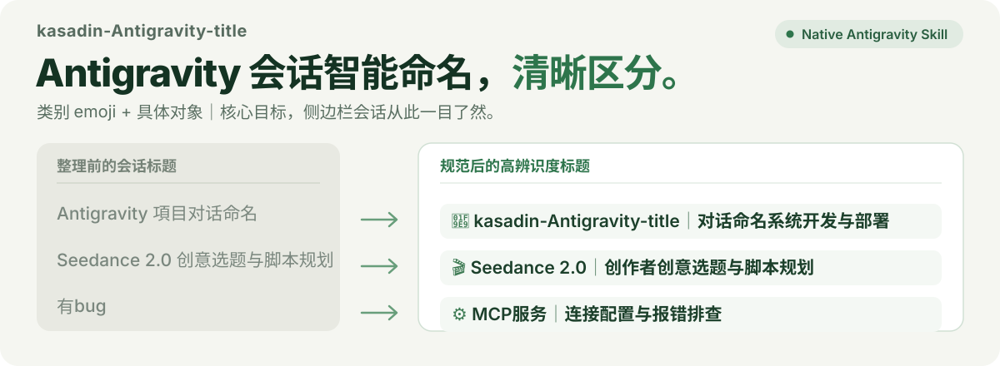

# kasadin-Antigravity-title

<p align="center">
  
</p>

<p align="center">
  <a href="README.md"><b>简体中文</b></a> ·
  <a href="README_EN.md"><b>English</b></a>
</p>

让 Antigravity 侧边栏的会话标题跟上你真正做的事情。自动提炼对话中的核心实体与持续目标，将混乱模糊的标题统一规整为 **「类别 emoji + 具体对象｜核心目标」**。会话再多，也能一眼找到。

---

## 一眼看出正在做什么

以下为真实会话整理效果对比：

| 原来的标题 | 更容易找回的标题 | 类别说明 |
| :--- | :--- | :--- |
| `Antigravity 項目对话命名` | `🧩 kasadin-Antigravity-title｜对话命名系统开发与部署` | 🧩 工具开发 |
| `Seedance 2.0 创意选题与脚本规划` | `🎬 Seedance 2.0｜创作者创意选题与脚本规划` | 🎬 创意制作 |
| `AMD Radeon RX 9000 Pricing` | `🔎 AMD Radeon RX 9000｜价格与规格调研` | 🔎 对比调研 |
| `安克AI黑客松参赛感想总结` | `📝 安克AI黑客松｜参赛感想与复盘总结` | 📝 知识整理 |
| `Macro Green Sichuan Pepper` | `🎨 青花椒摄影｜8K微距静物提示词设计` | 🎨 界面视觉 |
| `Accessing Local Feishu Cli` | `⚙️ 飞书CLI｜本地访问与配置联调` | ⚙️ 环境配置 |
| `拒绝无理亲戚要求` | `💬 人际沟通｜拒绝亲戚无理要求话术` | 💬 自由探讨 |
| `<无标题> (排查MCP报错)` | `⚙️ MCP服务｜连接配置与报错排查` | ⚙️ 环境排错 |

统一采用 **「类别 emoji + 具体对象｜核心目标」**：先找对象，再看在做什么。

- **对象在前**：把“飞书CLI”、“AMD Radeon RX 9000”、“Seedance 2.0”等核心辨识词置于最前，拒绝以“制作”“优化”“关于”等宽泛动词开头。
- **类别固定**：🎬 创意制作、🧩 工具开发、🔎 对比调研、🎨 界面视觉、📝 知识整理、⚙️ 环境配置、📅 项目规划、💬 自由探讨。同一个任务即使处于调试阶段，也不会丢失原本的领域分类。
- **名称稳定**：反映整段对话的持续工作主线，不因最后一句“继续”“报错了”“推送到Git”而频繁覆盖主干标题。
- **零外部依赖与保护隐私**：内置高精度启发式引擎，纯本地离线执行，不需要额外部署外部模型 API Key，对话内容不出本地。
- **由你控制**：支持单条与批量预览（`preview`）、精准指定修改（`rename`）、一键批量整理（`batch`）与一键安全回滚（`restore`）。
- **绝对数据安全**：任何写入操作执行前，自动通过 SQLite ACID 备份机制创建全量数据库时间戳快照，同时自动同步更新 Antigravity 的 FTS 全文搜索索引。

---

## 让 Antigravity 帮你安装与使用

直接复制下面这段话发给你的 Antigravity Agent：

```text
帮我使用本地的 kasadin-Antigravity-title 项目，检查当前环境状态并开启会话命名整理；如果检测到历史未规范命名的会话，请先提供预览，并在我确认后帮我一键格式化整理。
```

---

## 贴心的首次安装引导

当用户首次引入本 Skill 时，Agent 会自动检查当前会话的命名规范覆盖率。如果发现有历史对话尚未规范化，会主动发起询问：

> “检测到你当前 Antigravity 侧边栏中有 **24** 个历史会话（其中 **23** 个尚未采用结构化命名，当前规范覆盖率为 **4.2%**）。
> 
> **需不需要我帮你扫描并批量格式化整理你 Antigravity 过去所有的历史对话？**
> 
> 💡 *整理前会自动为数据库创建时间戳安全快照，随时支持一键完整还原。*”

---

## 日常怎么用

在 Antigravity 对话中，你可以随时直接说：

- “用 kasadin-title 查看会话命名覆盖率。”
- “预览当前会话的新标题。”
- “把当前会话重命名一下。”
- “帮我扫描并批量格式化整理所有历史对话。”
- “恢复上一次备份快照。”

---

## CLI 终端命令行速查

本项目零第三方依赖，Python 3 标准库直接免安装运行：

```bash
# 1. 环境诊断与数据库健康检查
python3 scripts/run.py doctor

# 2. 查看当前侧边栏会话的规范覆盖率
python3 scripts/run.py status

# 3. 列出顶层会话及其格式状态
python3 scripts/run.py list --limit 20

# 4. 预览待整理会话的新标题（只读安全，不修改任何文件）
python3 scripts/run.py preview --unformatted-only

# 5. 单条重命名（支持自动推断或手动指定）
python3 scripts/run.py rename 086b --apply
python3 scripts/run.py rename 086b --title "🧩 核心模块｜功能开发与联调" --apply

# 6. 一键批量重命名（自动前置创建 ACID 快照）
python3 scripts/run.py batch --apply --unformatted-only

# 7. 手动创建备份快照
python3 scripts/run.py backup

# 8. 从最近快照一键安全恢复
python3 scripts/run.py restore
```

---

## 项目结构

```text
kasadin-antigravity-title/
├── README.md                      # 中文主说明文档
├── README_EN.md                   # English Documentation
├── LICENSE                        # MIT 开源许可证
├── pyproject.toml                 # 项目元数据与打包规范
├── assets/readme/                 # 高清纯 SVG 视觉资产
│   ├── hero.svg
│   └── hero_en.svg
├── prompts/
│   └── naming.md                  # 核心命名规范与类别指导
├── kasadin_antigravity_title/     # 核心功能包
│   ├── __init__.py
│   ├── config.py                  # 路径定位与环境配置
│   ├── db_adapter.py              # SQLite 读写、FTS5维护与快照备份
│   ├── transcript_reader.py       # 轨迹与对话意图提取
│   ├── validator.py               # 规范校验与 Emoji/长度验证
│   ├── engine.py                  # 实体识别与高精度启发式引擎
│   └── cli.py                     # 终端命令行交互界面
├── scripts/
│   └── run.py                     # 一键免安装执行脚本
├── skills/
│   └── kasadin-antigravity-title/ # 原生 Antigravity Skill 定义
└── tests/                         # 自动化单元测试集（10/10 通过）
```

---

## 许可证

[MIT License](LICENSE) © 2026 kasadin
