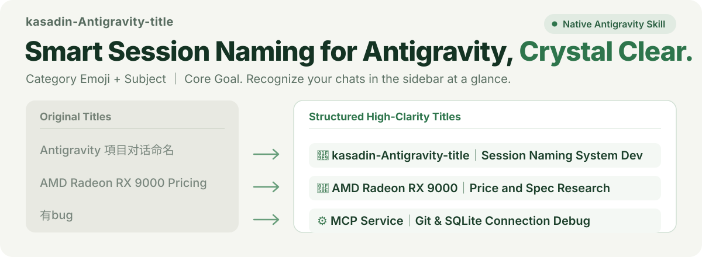

# kasadin-Antigravity-title

<p align="center">
  
</p>

<p align="center">
  <a href="README.md"><b>简体中文</b></a> ·
  <a href="README_EN.md"><b>English</b></a>
</p>

Keep your Antigravity conversation sidebar aligned with what you are actually doing. Automatically extracts core entities and sustained goals from dialogue trajectories, standardizing messy titles into the structured **"[Category Emoji] [Subject] ｜ [Core Goal]"** format. No matter how many conversations you accumulate, recognize them at a glance.

---

## Recognize Your Work at a Glance

Real-world before-and-after comparison in Antigravity:

| Original Title | Structured High-Clarity Title | Category |
| :--- | :--- | :--- |
| `Antigravity 項目对话命名` | `🧩 kasadin-Antigravity-title｜对话命名系统开发与部署` | 🧩 Tool Dev |
| `Seedance 2.0 创意选题与脚本规划` | `🎬 Seedance 2.0｜创作者创意选题与脚本规划` | 🎬 Creative |
| `AMD Radeon RX 9000 Pricing` | `🔎 AMD Radeon RX 9000｜价格与规格调研` | 🔎 Research |
| `安克AI黑客松参赛感想总结` | `📝 安克AI黑客松｜参赛感想与复盘总结` | 📝 Knowledge |
| `Macro Green Sichuan Pepper` | `🎨 青花椒摄影｜8K微距静物提示词设计` | 🎨 Visual Design |
| `Accessing Local Feishu Cli` | `⚙️ 飞书CLI｜本地访问与配置联调` | ⚙️ Environment |
| `拒绝无理亲戚要求` | `💬 人际沟通｜拒绝亲戚无理要求话术` | 💬 Discussion |
| `<Empty> (MCP Connection Error)` | `⚙️ MCP服务｜连接配置与报错排查` | ⚙️ Debugging |

Standardized schema: **"[Category Emoji] [Subject] ｜ [Core Goal]"** — Identify the subject first, then understand the ongoing mission.

- **Subject First**: Leading with high-recognition anchors like "Feishu CLI", "AMD Radeon RX 9000", or "Seedance 2.0", rather than starting with generic action verbs like "Make", "Improve", or "About".
- **Stable Categories**: 🎬 Creative Production, 🧩 Tool Development, 🔎 Competitive Research, 🎨 Visual Design, 📝 Knowledge Base, ⚙️ Environment & Setup, 📅 Project Scheduling, 💬 Open Discussion. A task keeps its domain identity even when entering testing or bug-fixing stages.
- **Sustained Goal Stability**: Reflects the ongoing objective of the session. Intermediate steps like "continue", "tests passed", or "push to Git" do not overwrite the primary goal.
- **Zero External Dependencies & Privacy-First**: Powered by a deterministic heuristic engine. Operates 100% offline without requiring external model API keys or transmitting private dialogue off your machine.
- **Full User Control**: Inspect dry-run results (`preview`), rename individual chats (`rename`), batch format history (`batch`), and restore instantly (`restore`).
- **Guaranteed Safety**: Automatically creates a timestamped SQLite ACID backup snapshot before executing any mutation, while keeping Antigravity's FTS5 full-text search index perfectly synchronized.

---

## Let Antigravity Set It Up for You

Copy and send this prompt to your Antigravity Agent:

```text
Help me inspect the local kasadin-Antigravity-title project and check my sidebar naming status; if there are unformatted past conversations, preview the proposed titles first, and batch format them upon my confirmation.
```

---

## Proactive First-Time Onboarding

When a user installs or first interacts with this Skill, the Agent automatically checks sidebar naming compliance. If unformatted conversations are detected, it proactively offers:

> "I detected **24** conversations in your Antigravity sidebar (**23** of which have not yet adopted structured naming, with a current compliance rate of **4.2%**).
> 
> **Would you like me to scan and batch format all your past Antigravity conversations?**
> 
> 💡 *A timestamped SQLite backup snapshot will be created automatically before any changes, supporting instant one-command restoration at any time.*"

---

## Everyday Usage

In any Antigravity conversation, you can simply say:

- "Check conversation title compliance with kasadin-title."
- "Preview the new title for this conversation."
- "Rename the current conversation."
- "Scan and batch format all my past conversations."
- "Restore from the last backup snapshot."

---

## CLI Command Reference

Zero third-party dependencies — runs directly on Python 3 standard library:

```bash
# 1. Environment diagnostic and database health check
python3 scripts/run.py doctor

# 2. View current title compliance rate
python3 scripts/run.py status

# 3. List top-level sidebar conversations and their status
python3 scripts/run.py list --limit 20

# 4. Preview proposed titles (read-only safety dry-run)
python3 scripts/run.py preview --unformatted-only

# 5. Rename a specific conversation (auto-inferred or manual)
python3 scripts/run.py rename 086b --apply
python3 scripts/run.py rename 086b --title "🧩 Core Module｜Feature Dev & Debug" --apply

# 6. Batch rename all unformatted conversations (with auto-backup)
python3 scripts/run.py batch --apply --unformatted-only

# 7. Manually create an ACID database backup snapshot
python3 scripts/run.py backup

# 8. Restore database from the most recent backup snapshot
python3 scripts/run.py restore
```

---

## Project Structure

```text
kasadin-antigravity-title/
├── README.md                      # Chinese Documentation (Primary)
├── README_EN.md                   # English Documentation
├── LICENSE                        # MIT Open Source License
├── pyproject.toml                 # Package metadata and entry points
├── assets/readme/                 # High-resolution pure SVG assets
│   ├── hero.svg
│   └── hero_en.svg
├── prompts/
│   └── naming.md                  # Core naming guidelines & prompt specs
├── kasadin_antigravity_title/     # Core package
│   ├── __init__.py
│   ├── config.py                  # Path resolution & environment setup
│   ├── db_adapter.py              # SQLite RW, FTS5 sync & ACID backups
│   ├── transcript_reader.py       # Trajectory and dialogue extraction
│   ├── validator.py               # Format validation, emojis & length rules
│   ├── engine.py                  # Entity extraction & heuristic engine
│   └── cli.py                     # Terminal command-line interface
├── scripts/
│   └── run.py                     # Zero-install single-file runner
├── skills/
│   └── kasadin-antigravity-title/ # Native Antigravity Skill specification
└── tests/                         # Automated test suite (10/10 passed)
```

---

## License

[MIT License](LICENSE) © 2026 kasadin
